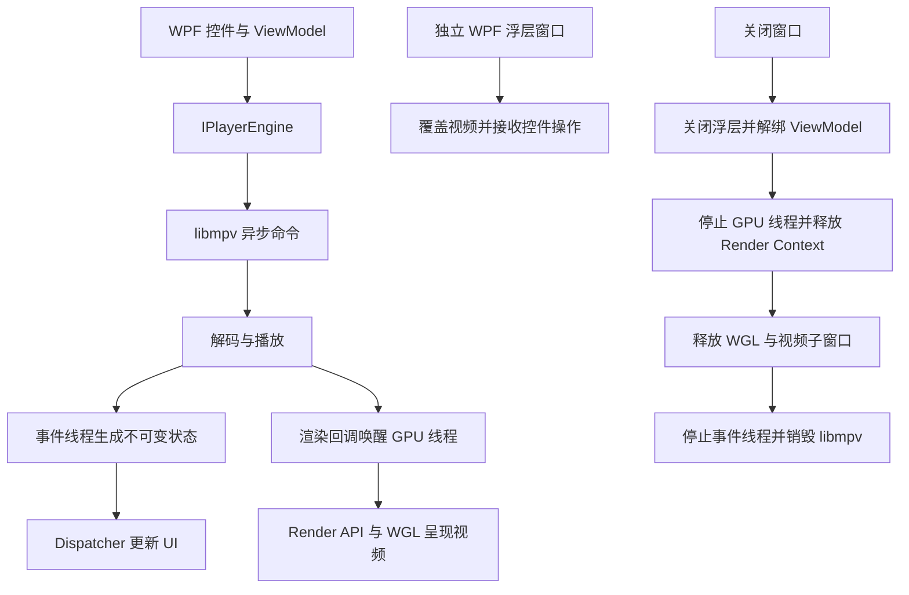

# 第一阶段渲染方案

## API 评估

libmpv 的公开 [Render API](https://github.com/mpv-player/mpv/blob/master/include/mpv/render.h) 列出 OpenGL 与 software 两种后端，没有可直接传入 D3D11 设备的 D3D11 Render API。mpv 自身的 D3D11 视频输出与 libmpv Render API 是不同接口，不能将“D3D11 硬件解码”当成“D3D11 Render API”。

本阶段采用公开的 [OpenGL Render API](https://github.com/mpv-player/mpv/blob/master/include/mpv/render_gl.h)，通过 WGL 在专属线程向原生子窗口交换链呈现。视频解码和渲染由 libmpv/FFmpeg 完成，正常播放不进行 GPU 帧读取或 CPU 逐帧复制。只有显式 `--verify` 模式会读取中心像素来验证图像实际变化。

硬件解码候选按 `d3d11va,d3d11va-copy,no` 顺序尝试；直接互操作不可用时允许 copy 路径，最终允许软件解码。当前显卡实测使用 `d3d11va-copy`，其中 copy 是解码输出到渲染路径的必要拷贝，不代表采用软件绘制视频。

## Airspace

WPF 控件不能通过 `Panel.ZIndex` 覆盖 `HwndHost`。视频控制层因此使用独立的透明 WPF owned window：

1. 主窗口持有视频子 HWND。
2. 控制浮层是主窗口的 owned HWND，不设置全局置顶。
3. 根据视频宿主的 `PointToScreen` 结果，使用物理像素定位浮层，适配 PerMonitorV2 DPI。
4. 布局、窗口移动、最小化和还原时更新浮层位置及可见性。
5. 对话框打开前隐藏浮层，结束后恢复。
6. 全屏复用同一播放会话和同一渲染器，只改变窗口及宿主布局。

自动验收通过 `WindowFromPoint` 检查倍速按钮中心点命中浮层 HWND，同时检查它的 owner 为主窗口，从原生窗口层面证明浮层没有被视频 HWND 遮挡。该检查与人工视觉截图检查分别记录。

## 线程和销毁顺序

原生回调只唤醒事件，不调用 WPF，也不在回调中调用 mpv。GPU 线程不向 UI 做同步调度，因此 UI 等待渲染线程退出时不会形成相互等待。异步命令使用 UTF-8 argv 参数数组，避免中文、空格路径及特殊字符的命令拼接问题。

## 后续验证

本阶段验证本机 NVIDIA GPU、H.264/AAC 及反复窗口切换。多显示器不同 DPI、其他显卡、Windows 10 LTSC/Enterprise 和长时间播放仍需在对应设备上验证。若后续引入 WPF D3DImage 零拷贝渲染，需要额外验证 OpenGL/D3D 共享纹理、设备丢失及适配器切换，保持 `IPlayerEngine` 边界不变。
