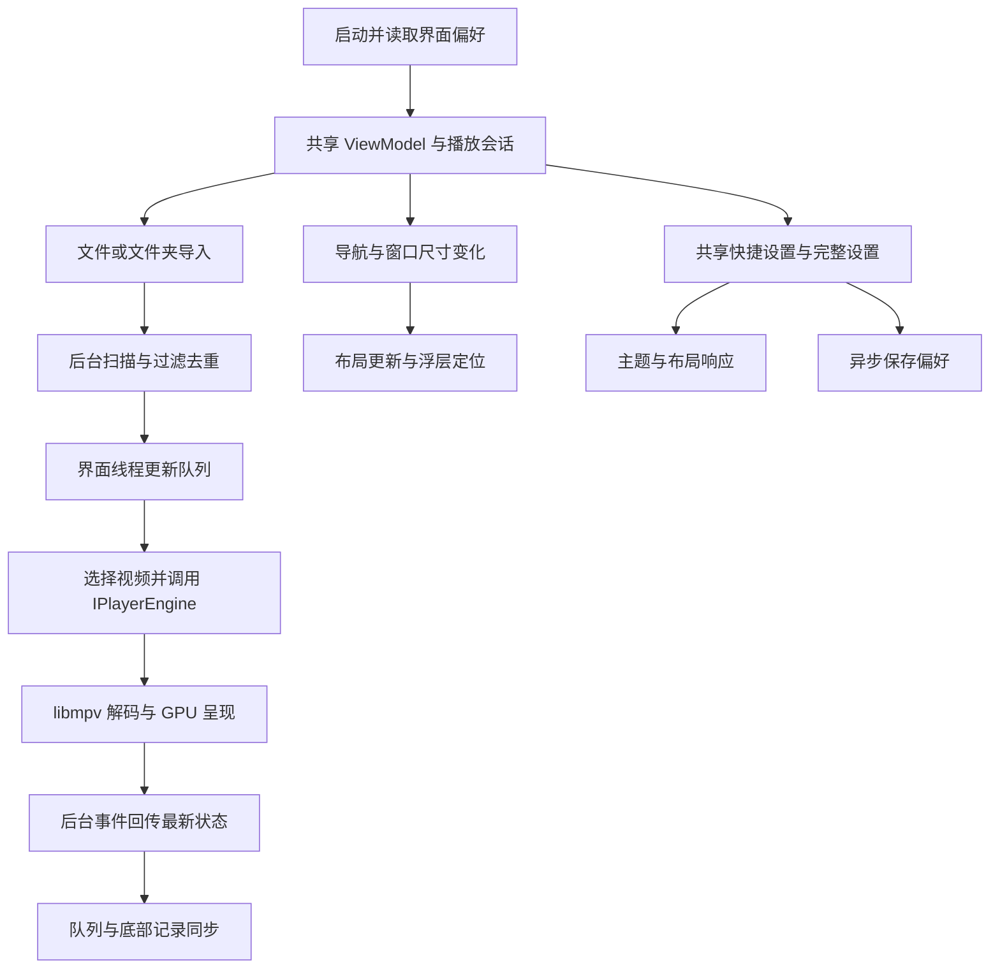

# 第二阶段主要代码链路

## 1. 应用启动：组装共享对象

`NovaPlayer.App/App.xaml.cs`：

```csharp
var preferences = await PreferencesService.LoadAsync(preferencesPath);
MainWindow = new MainWindow(engine, e.Args, preferences);
```

应用只创建一个播放内核，把已读取的偏好服务传给主窗口。主窗口组装唯一的 `PlayerViewModel` 和 `VideoHost`，所有区域共用它们。

## 2. 导入入口：后台扫描后更新队列

`NovaPlayer.App/ViewModels/PlayerViewModel.cs`：

```csharp
var imported = await MediaImportService.ImportAsync(paths, _lifetime.Token);
```

导入服务在线程池中扫描指定路径、过滤扩展名、读取文件元数据并去重。ViewModel 等待完成后回到 WPF 线程更新 `ObservableCollection`；导入互斥和生命周期取消令牌分别处理连续导入和窗口关闭。

```csharp
if (!Playlist.Contains(item)) Playlist.Add(item);
```

同一路径的队列与历史复用同一个 `VideoItem`，进度变化不需要维护多份副本。

## 3. 队列播放：选择条目并复用内核

```csharp
_pendingPosition = ResumePolicy.Position(item.Position, item.Duration, Preferences.AutoResume);
CurrentVideo = item;
_engine.SetSpeed(item.HasSpeed ? item.Speed : Preferences.DefaultSpeed);
_engine.Open(item.Path);
```

根据当前会话记录决定续播位置与倍速。新视频加载完成且时长有效后才执行待处理的跳转，避免在旧媒体上错误跳转。实际加载仍由 `IPlayerEngine` 后面的 libmpv 实现完成。

## 4. 状态回传：进度与显示使用同一快照

```csharp
_dispatcher.BeginInvoke(() => { if (!_disposed) State = _engine.State; }, DispatcherPriority.DataBind);
```

原生事件线程通知 UI 后，在 UI 线程读取最新内核快照，避免已排队的旧状态覆盖新状态。`OnStateChanged` 把时长、位置和倍速同步到当前条目，进度条与底部播放记录因此保持一致。

## 5. 导航：切换视图而不创建播放会话

```csharp
[RelayCommand] private void Navigate(string page)
{
    if (page is "首页" or "播放历史" or "设置") CurrentPage = page;
}
```

三个页面绑定 `IsHome`、`IsHistory` 和 `IsSettings`。`PlaybackOverlay.SyncBounds` 根据主窗口的 `ShouldShowPlayerOverlay` 隐藏或恢复浮层；视频宿主和渲染线程继续使用原实例。

## 6. 共享偏好：两处绑定、一次写入

```xml
IsChecked="{Binding Preferences.AutoResume}"
SelectedItem="{Binding Preferences.DefaultSpeed}"
```

首页快捷设置和设置页使用相同绑定路径。偏好变化通知布局和主题服务，并进入串行的异步 JSON 写入流程：

```csharp
await _writeGate.WaitAsync().ConfigureAwait(false);
await File.WriteAllTextAsync(temporary, JsonSerializer.Serialize(data)).ConfigureAwait(false);
File.Move(temporary, _path, true);
```

这三行是保存方法的关键节选。临时文件写完后替换正式文件，退出前刷新最后一次快照。改变默认倍速只影响后续没有独立记录的视频，不会改动当前播放速度。

## 7. 自适应：从窗口宽度推导显示规则

`src/NovaPlayer.Core/Presentation/ShellLayout.cs`：

```csharp
new(width < 1050 ? 72 : 190, width < 1050,
    width >= 1200 && playlistRequested, width < 1200);
```

规则只计算导航宽度、紧凑导航、列表可见性与底部纵向排列。`MainWindow.ApplyLayout` 再把结果应用到网格列宽、行高和控件位置。自动隐藏不覆盖用户的展开偏好，放大窗口后可恢复原状态。

## 8. 验收：真实状态与实际视觉分开检查

原生 `WindowFromPoint` 检查浮层按钮是否实际位于视频窗口之上；`ShellCapture` 把当前 WPF 视觉树和 GPU 画面导出用于视觉检查。GPU 画面回读仅发生在显式验收导出时，正常播放不执行逐帧回读。


