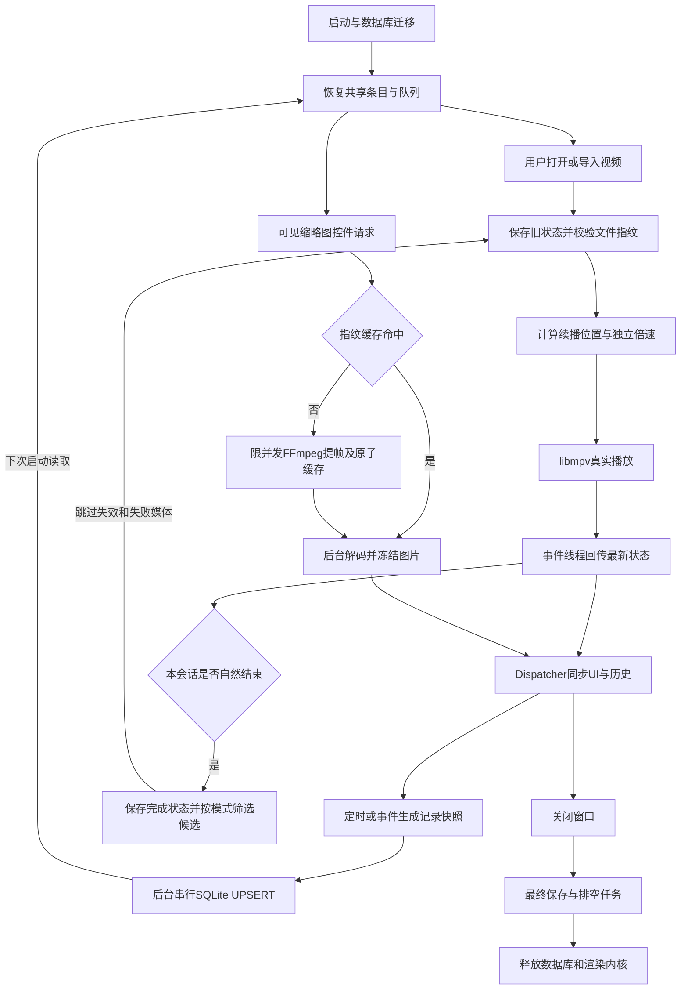

# 第三阶段逐环节代码链路

本文保留第三阶段代码说明；第四阶段扩展了接口、配置与窗口交互，当前高级播放流程见 [第四阶段说明](stage4-code-walkthrough.md)。

以下片段均来自当前实现，省略的辅助处理可在对应文件查看。SQLite 是 Microsoft.Data.Sqlite 提供的数据库访问依赖；`IPlaybackStore` 与 `IPlayerEngine` 是本项目自己的接口，分别隔离数据库实现和第三方 libmpv。

## 1. 启动与恢复：建立基础设施，再填充共享条目

入口 `NovaPlayer.App/App.xaml.cs`：

```csharp
var store = new SqlitePlaybackStore(Path.Combine(root, "data", "player.db"));
try { await store.InitializeAsync(); } catch (Exception ex) { Log.Error(ex, "数据库初始化失败，将继续启动播放器"); }
var thumbnails = new ThumbnailService(Path.Combine(AppContext.BaseDirectory, "native", "win-x64", "ffmpeg.exe"), Path.Combine(root, "cache", "thumbnails"));
await thumbnails.CleanAsync();
MainWindow = new MainWindow(engine, e.Args, preferences, store, thumbnails); MainWindow.Show();
```

数据库、封面和内核各有单一职责。数据库初始化异常记录日志并允许播放继续。主窗口在渲染器就绪后调用 `InitializeLibraryAsync()`，随后开放导入播放入口。

`NovaPlayer.App/ViewModels/PlayerViewModel.Persistence.cs`：

```csharp
var snapshot = await _store.ReadAsync();
foreach (var record in snapshot.Videos)
{
    var item = Materialize(record);
    if (item.HistoryVisible && item.LastPlayed is not null) History.Add(item);
}
foreach (string path in snapshot.Playlist)
    if (_library.TryGetValue(path, out var item)) Playlist.Add(item);
```

输入是 SQLite 快照，输出是 WPF 共享 `VideoItem`。队列、历史和最近观看复用同一个对象。恢复期间 `_restoringLibrary` 抑制反向写入，避免还没读完就覆盖队列。仅恢复选中项，不擅自开始播放。

## 2. 导入与播放：校验指纹，计算续播位置与倍速

`PlayerViewModel.ImportFilesAsync()` 后台扫描文件，再调用 `RegisterImportedAsync()`，用完整路径去重。`SqlitePlaybackStore.RegisterAsync()` 比较文件大小和修改时间，同指纹复用旧记录，文件变化则重置旧进度、速度和封面。

`PlayItemAsync()` 的关键顺序：

```csharp
await _transitionGate.WaitAsync(_lifetime.Token);
await SaveCurrentAsync();
```

先序列化切换并保存旧内核状态，再在线程池读取文件元数据。请求编号 `_playRequest` 使连续选片只有最新请求继续；生命周期令牌取消关闭期间的操作。缺失文件标记失效并发出重新定位事件。

```csharp
double resume = fromStart ? 0 : ResumePolicy.Position(item.Position, item.Duration, Preferences.AutoResume && !item.Completed);
if (resume > 0 && Preferences.ResumeMode == "询问后续播" && Confirm?.Invoke($"是否从 {FormatTime(resume)} 继续播放？") != true) resume = 0;
_pendingPosition = resume > 0 ? resume : null; _resumeIssued = false; ResumePrompt = null;
```

`ResumePolicy` 落实 5 秒、距尾 30 秒及 95% 的边界。询问模式通过窗口负责显示确认，业务层只接收布尔结果。

```csharp
_engine.SetSpeed(Preferences.RememberSpeed && item.HasSpeed ? item.Speed : Preferences.DefaultSpeed);
_engine.Open(item.Path);
```

这里调用的是项目接口，实际由 `MpvPlayerEngine` 转为 libmpv 属性和 `loadfile` 命令。UI 不直接访问底层 DLL。开始打开后，只有加载完成且时长有效时才进行续播跳转。

## 3. 状态回传：回到 UI 线程，同步实际进度

`NovaPlayer.App/ViewModels/PlayerViewModel.cs`：

```csharp
_dispatcher.BeginInvoke(() => { if (!_disposed) State = _engine.State; }, DispatcherPriority.DataBind);
```

libmpv 事件在线程池事件循环产生，ViewModel 用 Dispatcher 回到 WPF 线程读取最新快照。取最新状态可避免队列中旧事件覆盖新状态。

`ObservePlayback()`：

```csharp
if (!_resumeIssued)
{ _resumeIssued = true; _engine.Seek(Math.Min(target, value.Duration)); return; }
if (value.Position < target - 1 || value.IsSeeking) return;
_pendingPosition = null; _resumeIssued = false; ShowResumePrompt(target);
```

跳转未确认前保留旧持久化位置；完成后清除待恢复目标，并显示 6 秒提示。`SeekTo()` 在用户主动拖动时清除待恢复目标，避免旧续播操作干扰用户。之后同一状态同步当前条目的位置、时长、速度与完成标记，控制栏和底部记录共用它。

## 4. 保存进度：定时 / 事件触发，生成不可变快照

`PlayerViewModel` 创建 5 秒 DispatcherTimer，暂停变化、跳转完成、速度变化、加载、切换和退出也会调用 `SaveCurrentAsync()`。

```csharp
var state = _engine.State;
if (_pendingPosition is not null || !state.IsLoaded || state.FilePath is null || !_library.TryGetValue(state.FilePath, out var item)) return Task.CompletedTask;
```

保存从内核读取，避免使用显示延迟的 UI 值。未加载或尚在恢复时不覆盖已保存的有效位置。

```csharp
item.Completed = state.IsEnded || state.Duration > 0 && item.Position / state.Duration >= 0.95;
var record = item.ToRecord() with { Position = item.Position >= 5 ? item.Position : 0 };
return PersistAsync(() => _store.SaveVideoAsync(record));
```

输出 `VideoRecord` 是快照，后台写入期间 UI 可以继续变化。`PersistAsync` 捕获数据库错误，显示非阻塞提示，后续成功写入时清除临时提示。

## 5. SQLite 工作队列：后台串行写入与原子事务

`src/NovaPlayer.Infrastructure/Database/SqlitePlaybackStore.cs`：

```csharp
private readonly Channel<Action> _queue = Channel.CreateUnbounded<Action>(new UnboundedChannelOptions { SingleReader = true });
```

```csharp
_worker = Task.Run(async () =>
{
    await foreach (var work in _queue.Reader.ReadAllAsync().ConfigureAwait(false)) work();
});
```

所有读写经 `Enqueue` 投入后台单消费者，结果通过 `TaskCompletionSource` 异步完成。Microsoft.Data.Sqlite 的同步调用只在后台执行，每次连接有 2 秒锁超时，失败不会结束消费者。

```sql
ON CONFLICT(file_key) DO UPDATE SET file_path=excluded.file_path,file_name=excluded.file_name,file_size=excluded.file_size,
file_modified_at=excluded.file_modified_at,duration=excluded.duration,last_position=excluded.last_position,
playback_speed=excluded.playback_speed,last_played_at=excluded.last_played_at,is_completed=excluded.is_completed,
```

这段 UPSERT 更新同路径记录，参数通过 `AddWithValue` 绑定，中文、空格和引号路径不拼接 SQL。队列整表替换在事务中提交，保存顺序及当前条目。schema 迁移也使用事务；遇到未来版本拒绝覆盖。完整性检查发现损坏时先归档数据库和 WAL/SHM，再建新库并导入可读记录。

## 6. 历史操作：共享条目过滤与持久化隐藏

`PlayerViewModel.cs`：

```csharp
foreach (var item in History.Where(v => v.HistoryVisible && v.Name.Contains(HistorySearch.Trim(), StringComparison.OrdinalIgnoreCase)).OrderByDescending(v => v.LastPlayed)) FilteredHistory.Add(item);
```

历史按观看时间排序，搜索只匹配已知记录。`HistoryView` 菜单将条目传入继续 / 从头 / 定位 / 删除命令。

```csharp
foreach (var item in _library.Values) item.HistoryVisible = false;
History.Clear(); RefreshHistory(); Notice = "播放记录已清空，原视频与队列已保留。";
_ = PersistAsync(() => _store.SetHistoryVisibilityAsync(null, false));
```

清空需确认，按可见标志隐藏历史并保存。视频元数据、独立记忆及队列仍保留，原视频完全不受影响。播放中的后续定时保存尊重隐藏标志，显式重新打开才重新进入历史。

## 7. EOF 与连播：会话去重、有限候选、用户操作优先

`ObservePlayback()`：

```csharp
if (value.IsEnded && _handledEndSession != value.SessionId)
{
    _handledEndSession = value.SessionId; _failedAutomaticPaths.Clear();
    _ = AdvanceAfterEndAsync(value.SessionId, item, false);
}
```

一个播放会话只处理一次 EOF；同视频循环通过重新打开获得新的 `SessionId`。`AdvanceAfterEndAsync()` 先保存完成状态，再由 Core 的 `PlaylistPolicy.NextCandidates()` 给出有限候选。

```csharp
if (_shuttingDown || _engine.State.SessionId != session || _playRequest != request) return;
next.IsMissing = !exists;
if (!exists) { _failedAutomaticPaths.Add(next.Path); continue; }
_failedAutomaticPaths.Add(next.Path);
await PlayItemAsync(next, Preferences.Mode == PlaybackMode.SingleRepeat || next.Completed, true);
```

存在性校验在线程池；等待时用户若手动选片，旧连播立即终止。缺失文件直接跳过，解码失败通过错误事件继续候选；失败集合避免列表循环在坏文件之间无限重试。

## 8. 缩略图：可见区域触发、后台提帧、回到 UI 解码绑定

`NovaPlayer.App/Controls/VideoThumbnail.xaml.cs`：

```csharp
if (Item?.ThumbnailLoader is not { } load || Item.Thumbnail is not null) return;
try { await load(Item, _visible.Token); } catch (OperationCanceledException) { }
```

控件 Loaded 发起请求，Unloaded 取消；列表启用回收虚拟化，不批量为不可见记录生成封面。多个区域请求同一文件时，`ThumbnailService` 用指纹字典合并任务，SemaphoreSlim 最多允许两路 FFmpeg。路径、大小、修改时间构成 SHA256 键。

`src/NovaPlayer.Infrastructure/Thumbnails/ThumbnailService.cs`：

```csharp
await _slots.WaitAsync(token).ConfigureAwait(false);
```

缓存命中直接复用 JPEG 与时长元数据；没有缓存时，通过隐藏进程与参数数组调用 FFmpeg。候选帧过滤低亮度黑屏，单次 12 秒超时，取消会终止自己的子进程并等待退出。提帧完成后再次校验文件指纹，临时图片原子替换正式缓存；失败保留默认视频图标。

`PlayerViewModel.Persistence.cs`：

```csharp
bitmap.UriSource = new Uri(result.Path); bitmap.DecodePixelWidth = 320; bitmap.EndInit(); bitmap.Freeze(); return bitmap;
```

图片在线程池解码，使用 OnLoad 关闭文件引用并 Freeze，回到 UI 线程再绑定。`SetThumbnailAsync(record, result)` 按指纹条件更新缓存路径和未知时长，旧任务不能覆盖已变更文件。

## 9. 退出：停止新操作，排空最终写入，再释放内核

`ShutdownAsync()`：

```csharp
await SaveCurrentAsync(); await PersistPlaylistAsync();
await Preferences.SaveAsync();
await _thumbnails.DisposeAsync();
await PersistAsync(_store.FlushAsync);
```

先停止计时器、取消导入 / 切换、等待互斥区退出，再保存最终内核状态和队列、刷新配置、取消并等待提帧、排空 SQLite。

```csharp
await _store.DisposeAsync(); Dispose();
```

主窗口的第一次 Closing 取消同步关闭并等待上述异步过程；结束后释放渲染上下文、视频宿主和 libmpv，再真正关闭窗口。保存失败记录日志且仍执行资源释放。


