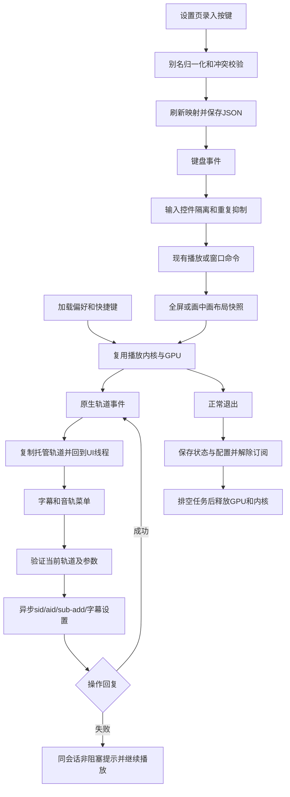

# 第四阶段逐环节代码链路

本文片段对应当前项目。业务层只调用项目自定义的 `IPlayerEngine`；轨道属性和播放命令由 Infrastructure 映射至第三方 libmpv。当前 WPF、GPU 渲染、SQLite 与封面缓存仍复用既有实例。

## 1. 启动：读取共享偏好与快捷键

`NovaPlayer.App/App.xaml.cs`：

```csharp
var preferences = await PreferencesService.LoadAsync(preferencesPath);
var shortcuts = await ShortcutService.LoadAsync(Path.Combine(root, "settings", "shortcuts.json"));
```

配置异步读取后注入主窗口和 ViewModel。旧版本 JSON 缺少的新字段采用默认值。主窗口加载时恢复有效窗口位置，渲染器就绪后再开放播放。`PlayerViewModel.Media.cs` 把播放偏好传给内核：

```csharp
Execute(() => _engine.Configure(new(Preferences.AutoLoadSubtitles, Preferences.PitchCorrection, Preferences.HardwareDecoding, Preferences.AutoMuteHighSpeed)));
Execute(() => _engine.SetSubtitleSize(Preferences.SubtitleSize));
```

`Configure()` 比较前后选项，只应用变化。硬件解码保存到待用配置，下次打开时在 `ApplyHardwareBeforeOpen()` 同步确认应用；ViewModel 使用 `await Task.Run(() => _engine.Open(item.Path), _lifetime.Token)` 将此准备放在线程池，再加载媒体，避免重建当前解码器扰动暂停位置，也避免同步原生设置阻塞 UI。

## 2. 轨道回传：在原生事件有效期内复制数据

`src/NovaPlayer.Infrastructure/Playback/MpvPlayerEngine.cs`：

```csharp
Observe("track-list", MpvNative.Node);
Observe("sid", MpvNative.Int64); Observe("aid", MpvNative.Int64);
```

`MpvTrackReader.cs` 按 x64 ABI 读取数组 / 映射节点，复制 ID、类型、语言、标题、编码和外挂路径为不可变 `MediaTrack`。不跨事件保留原生指针，也不释放属于事件的内存。

```csharp
var tracks = p.Data == 0 ? Array.Empty<MediaTrack>() : MpvTrackReader.Read(p.Data);
Update(s => s.Tracks.SequenceEqual(tracks) ? s : s with { Tracks = tracks });
```

输出进入 `PlayerState`。既有 `EngineStateChanged()` 使用 Dispatcher 回到 UI 线程读取最新快照；`SubtitleTracks`、`AudioTracks` 与视频信息只从该真实状态派生，不制造轨道。

## 3. 菜单选择：条目参数 → ViewModel → 内核校验 → 异步属性

`NovaPlayer.App/Controls/PlaybackOverlay.xaml.cs` 的字幕菜单：

```csharp
foreach (var track in tracks)
    menu.Items.Add(new MenuItem { Header = track.DisplayName, IsCheckable = true, IsChecked = _viewModel.State.SubtitleId == track.Id, Command = _viewModel.SelectSubtitleCommand, CommandParameter = track });
```

`PlayerViewModel.Media.cs`：

```csharp
[RelayCommand] private void SelectSubtitle(MediaTrack? track) { if (track is not null) Execute(() => _engine.SelectSubtitle(track.Id)); }
```

内核先确认当前媒体存在该类型 / 编号，再发送异步设置：

```csharp
ValidateTrack(id, MediaTrackKind.Subtitle);
SetString("sid", id.ToString(CultureInfo.InvariantCulture), "切换字幕");
SetSubtitlesVisible(true);
```

音轨走相同链路，设置 `aid`。轨道少于两条时不提供无效的切换菜单。新会话到达时关闭旧菜单，避免新媒体复用同一编号后误用旧条目。切换没有调用 `Open()`，因此不重置播放会话或位置。

## 4. 外挂、字号与偏移：保留播放和字幕样式

`MpvPlayerEngine.LoadSubtitle()` 校验本地文件和扩展名；已加载的外挂按路径复用轨道，否则发出带请求编号的命令：

```csharp
CommandWithRequest(Issue("加载外挂字幕"), "sub-add", path, "select");
```

启动选项 `sub-auto=exact`、`sub-auto-exts=srt,ass,ssa` 负责同目录同名检测；关闭自动字幕后下次打开媒体生效。无字幕显示明确空状态。

```csharp
SetDouble("sub-scale", size / 55, "调整字幕缩放");
SetDouble("sub-delay", seconds, "调整字幕偏移");
```

字号范围为 20～90，以 55 为基准缩放，保留 ASS/SSA 原样式。时间偏移限制在 ±600 秒，正值延后。字号保存到共享偏好，偏移随媒体重新打开重置；全屏 / 画中画切换不会打开媒体，因此保持偏移。图像字幕不能通过字号设置重排字形。

## 5. 异步失败：请求编号与会话关联，播放状态保持有效

`Issue()` 记录 `(SessionId, Label)`，原生属性 / 命令回复按编号移除：

```csharp
if (_operations.TryRemove(ev.UserData, out var operation))
```

仅同会话的失败显示提示，旧媒体的迟到回复不会污染新媒体：

```csharp
Update(s => s with { OperationWarning = $"{operation.Label}失败：{Marshal.PtrToStringUTF8(MpvNative.mpv_error_string(ev.Error))}；视频继续播放。" });
```

字幕 / 音轨操作失败写入 `OperationWarning` 并记录日志，不设置致命 `Error`，也不把 `IsLoaded` 清零。首页状态区与小窗提示条显示原因；有效的重新选择可清除提示。参数和文件错误由 ViewModel 的 `Execute()` 捕获。

## 6. 自定义快捷键：录入、归一化、冲突校验、原子替换

`NovaPlayer.App/Views/SettingsView.xaml.cs`：

```csharp
Key key = e.Key == Key.System ? e.SystemKey : e.Key;
vm.Shortcuts.Assign(item.Definition.Action, new(key.ToString(), (ShortcutModifiers)(int)Keyboard.Modifiers));
```

输入框只录入组合键，纯修饰键和自动重复不提交。`ShortcutService` 归一化 OEM / Enter 等枚举别名，交给 Core 的 `ShortcutMap` 验证：

```csharp
if (!_map.TryAssign(action, gesture, out var error)) { Message = error; return false; }
```

冲突返回中文原操作名称并保持旧绑定；成功刷新同一份可观察条目，按钮提示和首页摘要随之更新。批量读取先校验完整候选再替换，因此两个动作交换按键也能正常恢复。清除使用空绑定，恢复默认重建默认映射。

保存通过信号量串行写临时 JSON，再原子替换正式文件。坏配置启用默认值并保持原文件；没有用户编辑时退出保存也不覆盖；首次修改先备份原件。

## 7. 快捷键分发：输入编辑隔离与重复动作控制

主窗口和视频浮层都进入 `MainWindow.TryHandleShortcut()`：

```csharp
if (!_viewModel.IsReady || IsEditing(focus)) return false;
var action = _viewModel.Shortcuts.Resolve(key, modifiers, repeated);
```

`IsEditing()` 沿父级识别文本、密码和下拉控件。键盘编辑不会触发播放器。映射允许快进、音量与倍速连续重复，暂停 / 全屏等开关动作忽略重复。

```csharp
case ShortcutAction.TogglePause: _viewModel.TogglePauseCommand.Execute(null); break;
case ShortcutAction.Fullscreen: ToggleFullscreen(); break;
```

分发仍调用既有命令。快进 / 快退读取共享 `SeekInterval`，并与图标和提示同步。退出动作优先关菜单，再退出画中画 / 全屏。

## 8. 画中画：保存窗口快照，保持唯一媒体与 GPU

`NovaPlayer.App/MainWindow.xaml.cs`：

```csharp
_beforeMini = WindowPlacement.Capture(this); _beforeMiniPage = _viewModel.CurrentPage;
_overlay?.CloseMenu(); WindowState = WindowState.Normal;
_viewModel.CurrentPage = "首页"; _viewModel.IsMiniPlayer = true;
MinWidth = 280; MinHeight = 158;
```

默认使用 400×225 或此前记忆的小窗几何。`WindowPlacement.Apply()` 根据目标显示器工作区约束位置，避免显示器移除后窗口不可见。正常返回保留原窗口尺寸，恢复先前页面和最大化状态。

```csharp
_viewModel.Preferences.MiniGeometry = WindowPlacement.Capture(this) with { Maximized = false };
```

切换只改变现有窗口布局与置顶状态。`VideoHost`、原生 HWND、libmpv 与 WGL 上下文一直保留，窗口尺寸事件触发原渲染器 Resize，不创建第二个解码实例。小窗支持拖动，最小尺寸缩放控制栏；关闭小窗取消退出并返回主窗口。异常回退主窗口，保留媒体会话。

浮层覆盖小窗全部区域，因此额外提供八向透明 Thumb，避免其挡住主窗口原生缩放边缘。`MiniResize_DragDelta()` 将逻辑像素增量交给主窗口，按边缘方向修改尺寸并约束最小值；左 / 上边缘同时调整位置，保持另一侧不动：

```csharp
if (sender is Thumb { Tag: string edges }) _main.ResizeMiniPlayer(edges, e.HorizontalChange, e.VerticalChange);
```

Thumb 被识别为交互控件，不会同时触发画面拖动或双击全屏。

## 9. 全屏控制层与设置持久化、退出释放

`PlaybackOverlay.HideIdleControls()`：

```csharp
if (!_viewModel.State.IsLoaded || SpeedPopup.IsOpen || _contextMenu?.IsOpen == true || _dragging || BottomChrome.IsMouseOver) return;
if (DateTime.UtcNow - _lastActivity < TimeSpan.FromSeconds(_viewModel.Preferences.ControlsHideSeconds)) return;
```

隐藏控制层时同时取消其命中，鼠标活动恢复透明度和命中；菜单 / 拖动保持显示。全屏和画中画分别保存布局快照，互相转换时复用会话。

关闭前记录主 / 小窗几何，再沿第三阶段退出流程执行最终写入：

```csharp
await Preferences.SaveAsync();
await Shortcuts.SaveAsync();
```

随后等待封面任务和 SQLite 队列，解除事件订阅，先释放渲染上下文，再销毁 libmpv。新增的浮层会话订阅在 Closed 中解除，不留下窗口引用。



接口依据：[mpv 轨道属性](https://mpv.io/manual/master/#property-list)、[字幕选项](https://mpv.io/manual/master/#subtitles)、[libmpv client.h](https://github.com/mpv-player/mpv/blob/master/include/mpv/client.h)。实际 ABI 同时核对了项目固定下载版本附带的头文件。
