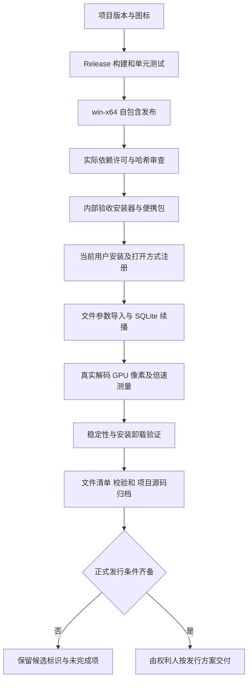

# 第五阶段逐环节代码链路

## 1. 项目元数据与图标

`NovaPlayer.App/NovaPlayer.App.csproj`：

```xml
<AssemblyName>NovaPlayer</AssemblyName>
<RootNamespace>NovaPlayer.App</RootNamespace>
<Version>1.0.0-rc.1</Version>
<ApplicationIcon>Assets/NovaPlayer.ico</ApplicationIcon>
```

程序集产物统一命名为 NovaPlayer.exe / NovaPlayer.dll，保持原有 C# 命名空间。ApplicationIcon 将多分辨率图标写入 EXE 资源；MainWindow 在 InitializeComponent 后设置同一 ICO，确保窗口、任务栏、文件关联一致。`New-ApplicationIcon.ps1` 为每个尺寸单独绘制，并在 finally 中释放流、画刷、Pen、GraphicsPath、Graphics 和 Bitmap。

## 2. Release 构建与自包含目录

`scripts/Build-Release.ps1`：

```powershell
& "$PSScriptRoot/Build.ps1" -Configuration Release
& $DotnetCommand restore (Join-Path $taskRoot 'NovaPlayer.App/NovaPlayer.App.csproj') -r win-x64 --configfile (Join-Path $taskRoot 'NuGet.Config') --nologo
```

随后检查绝对输出路径，清理本版本的 player 目录，再执行：

```powershell
& $DotnetCommand publish (Join-Path $taskRoot 'NovaPlayer.App/NovaPlayer.App.csproj') -c Release -r win-x64 --self-contained true -o $publish --no-restore --nologo
```

Build.ps1 负责还原、Release 构建及单元测试；此处补齐 RID 运行时资产，产出无需全局 .NET 的离线目录。每个外部工具调用后检查退出码，失败终止打包。版本输出目录经确认后才递归清理，不触碰源码、用户媒体与日常播放档案。

## 3. 从真实产物导出依赖资料

`scripts/Export-DependencyAudit.ps1`：

```powershell
$deps = Get-Content -LiteralPath (Join-Path $publish 'NovaPlayer.deps.json') -Raw -Encoding UTF8 | ConvertFrom-Json
$packages = @($deps.libraries.PSObject.Properties | Where-Object { $_.Value.type -eq 'package' } | ForEach-Object Name)
```

再合并 runtimeconfig 中 includedFrameworks 的 .NET Core / Desktop Runtime 包。按 id/version 查找本地 NuGet 缓存，保留 nuspec、版权、许可证和 notices，记录 NuGet 原始包 SHA512。新许可表达式不在已审查范围时停止。

依赖 JSON 使用两代 Shell 均支持的对象属性枚举；清单相对路径从核对后的绝对目录前缀提取，避免使用 .NET Framework 缺少的 Path.GetRelativePath。打包入口及其关联脚本保存为带 BOM 的 UTF-8，并显式以 UTF-8 读取 JSON/XML，防止 Windows PowerShell 5.1 误读中文和版权字符。

FFmpeg 的正常说明也可能写到标准错误流。`Read-FfmpegInformation` 使用 ProcessStartInfo 分别异步读取标准输出和标准错误，以真实退出码判断失败，避免 PowerShell 5.1 将普通说明转换为 NativeCommandError。设置 30 秒超时，finally 释放进程对象；两条管道同时读取，避免一方写满后互相等待。

```powershell
if ((Get-FileHash -LiteralPath $file -Algorithm SHA256).Hash -ne $expected) { throw "原生运行库发生变化，必须重新审查：$name" }
```

原生文件使用固定 SHA256，并实测 `ffmpeg -version/-L`。现有组合构建含 GPLv3，完整对应源码与自有代码发行许可尚未落实，所以 audit 和 manifest 明确写 `externalDistributionReady=false`。项目源码 ZIP 仅交付本项目，不冒充原生库的完整对应源码。

## 4. 安装器打包与当前用户注册

`scripts/Build-Release.ps1`：

```powershell
$compiler = & "$PSScriptRoot/Setup-InstallerTool.ps1"
& $compiler "/DPublishDir=$publish" "/DReleaseDir=$release" (Join-Path $taskRoot 'installer/NovaPlayer.iss')
```

编译工具被固定版本和哈希约束。`installer/NovaPlayer.iss`：

```ini
PrivilegesRequired=lowest
ArchitecturesAllowed=x64os
MinVersion=10.0.19044
DefaultDirName={localappdata}\Programs\NovaPlayer
```

安装完整自包含目录，不联网下载组件。固定 AppId 支持覆盖安装，开始菜单与可选桌面快捷方式均使用应用图标。安装页明确标示候选版及发行条件。

文件关联的核心命令是：

```ini
Root: HKCU; Subkey: "Software\Classes\NovaPlayer.Video\shell\open\command"; ValueType: string; ValueData: """{app}\{#AppExe}"" ""%1"""; Tasks: fileassociations
```

`%1` 和程序路径独立加引号，中文/空格路径不会被拆分。12 个扩展名仅加入 OpenWithProgids 候选，Capabilities 向系统声明支持范围，RegisteredApplications 提供默认应用候选入口。实际默认值和 UserChoice 由 Windows 用户选择流程管理。

## 5. 关联文件启动、数据库恢复与真实播放

`NovaPlayer.App/MainWindow.xaml.cs`：

```csharp
await _viewModel.ImportFilesAsync(_args.Where(File.Exists));
```

App 启动时后台创建 MpvPlayerEngine，异步读取设置/快捷键和 SQLite，然后创建主窗口。RendererCreated 等待 GPU Ready 和 InitializeLibraryAsync 后才处理命令行文件。导入服务在后台检查真实文件，SQLite 注册或恢复记录，ViewModel 在 UI 线程更新集合并调用已有 PlayItemAsync；播放打开与解码配置在后台执行，后续状态通过 Dispatcher 同步到界面。续播由已有状态机等待加载/时长后定位，而不是只设置 UI 进度条。

安装测试通过实际注册命令模板打开中文媒体，尾部显式 `--verify-file-open` 参数仅用于隔离测试档案、断言播放/续播并自动退出，正常路径仍然先执行上述 ImportFilesAsync。两个独立进程分别保存和恢复 12 秒位置。

`src/NovaPlayer.Infrastructure/Playback/MpvPlayerEngine.cs` 的兼容性修复：

```csharp
SetDouble("hr-seek-demuxer-offset", extension is ".ts" or ".m2ts" or ".mpg" or ".mpeg" ? 10 : 0);
Command("seek", target.ToString("R", CultureInfo.InvariantCulture), "absolute+exact");
```

传输流/节目流可能没有可靠的关键帧索引，实际验证曾跳到目标之后。使用 mpv 官方补偿选项提前读入，再精确解码到目标；其他容器恢复为 0，避免不必要的额外解码。代价是这些索引较差的文件定位可能更慢，原生命令异步执行，不阻塞 WPF 界面。

## 6. 编码、真实像素、倍速和稳定性验证

`scripts/New-ReleaseFixtures.ps1` 通过真实 FFmpeg 编码/封装生成 16 个样片及计划。`Verify-Stage5.ps1` 启动发布目录中的程序，把计划和独立报告路径传入 `--verify-release`，只等待并管理本轮子进程，超时停止本轮实例。

`NovaPlayer.App/Verification/StageFiveVerification.cs`：

```csharp
renderer.CaptureVerificationSamples = true;
long before = renderer.Frames;
int samples = renderer.DistinctSamples;
await Until(() => renderer.Frames > before + 3 && renderer.DistinctSamples > samples);
renderer.CaptureVerificationSamples = false;
```

每个样片先核对真实变化的 GPU 像素和状态中的编码/尺寸。确认后关闭回读，在生产路径中暂停、定位、设 15 倍速、恢复播放，通过真实 Position 增量除以 Stopwatch 时间计算实际速率。GPU render thread 继续独立运行；UI 线程使用 await 和条件超时等待，不以同步 Sleep 阻塞消息处理。

```csharp
double rate = (engine.State.Position - start) / watch.Elapsed.TotalSeconds;
var diagnostics = await Task.Run(engine.ReadDiagnostics);
```

ReadDiagnostics 只读取固定白名单属性，在后台加锁与 Dispose 互斥。原生 `mpv_get_property_string` 返回内存立即复制成托管字符串，finally 调用 `mpv_free`，不会泄漏原生字符串，也不会暴露任意命令执行接口。

持续运行段先预热全屏、小窗和主窗口，确保比较等价状态；预热与正式循环会在必要时 seek 到起点并解除片尾暂停。它反复切换 1/15 倍速和窗口形态，记录私有内存、托管堆、累计分配、Gen2、句柄、线程、帧数，并要求真正渲染推进。有限时长的通过结果不等于长期绝无泄漏。报告保留计划、OS、架构、GPU、运行时和实际应用 DLL SHA256。

## 7. 安装后验证、退出和卸载

`scripts/Verify-Installer.ps1`：

```powershell
Check '文件打开命令正确引用程序和媒体路径' ($command -eq ('"' + $exe + '" "%1"'))
```

安装前若发现自有 ProgID、安装记录或候选值已经存在，停止隔离测试，防止覆盖用户安装。保存原有扩展名默认值及 UserChoice；安装后核对 12 个候选且确认原默认值未变。完成两个进程播放、进度恢复和覆盖安装后执行本次卸载，并再次核对默认值与自有项清理。

播放进程正常退出时沿用 `CloseSessionAsync`：保存最后的进度、队列、设置，等待后台持久化；关闭控制层，停止并 join 渲染线程，释放 mpv render context / WGL，再终止 mpv 事件循环和会话。卸载器不递归删除用户资料目录。

## 8. 清单、归档和 Git

`scripts/Build-Release.ps1` 对 player 逐文件记录 SHA256，再计算安装器、便携 ZIP、项目源码 ZIP 的校验和。`Test-ReleaseManifest.ps1` 验证路径边界、文件数、大小、哈希、归档哈希、ICO 图像数量和依赖数量，文件改变即失败。

任务结束只 git add 本次自有源码/脚本/图标/安装器定义/许可原文/文档，保留用户原型 PNG 未跟踪状态；产物、依赖缓存、测试媒体和数据库按 .gitignore 保持本地，不提交或推送。


