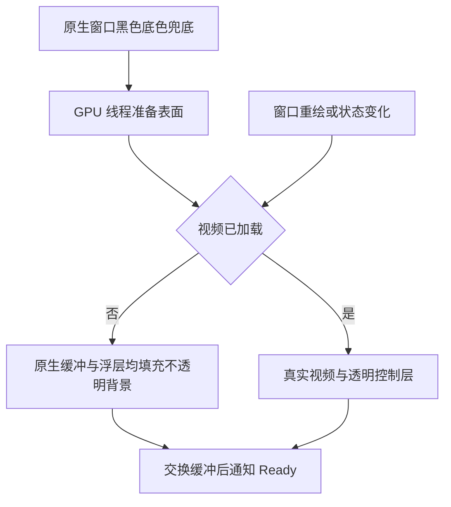

# 视频区域桌面穿透修复（2026-10-26）

用户截图显示未加载视频时，桌面壁纸和图标透过视频区域显示。原空闲浮层的背景 `#01080B12` 几乎透明，原生视频子窗口又没有背景画刷，背景绘制依赖 mpv 更新与尺寸通知。创建上下文也被提前当成 Ready，不能保证已经呈现首帧。

原有 ShellCapture 会请求 GPU 重新渲染，再以 Bgra32 合成图片，可能掩盖初始绘制缺陷。本次同时检查 GPU 原始 RGBA 和浮层自身 alpha，不再仅凭合成截图判断没有穿透。

## 逐环节代码

1. `NovaPlayer.App/Controls/VideoHost.cs` 注册窗口时使用系统黑色背景画刷兜底首帧和擦除间隙：

   ```csharp
   Instance = GetModuleHandle(null), Background = GetStockObject(4), ClassName = "NovaPlayerGpuSurface"
   ```

   系统画刷不由应用删除。WndProc 收到 WM_PAINT / WM_ERASEBKGND 时调用 ResizeRenderer，只更新尺寸并唤醒 GPU 线程；暂停时不必等下一帧解码才能恢复画面。

2. `src/NovaPlayer.Infrastructure/Rendering/MpvGlRenderer.cs` 请求 24 位颜色、无 alpha 的视频表面；空闲/播放状态变化也触发重绘：

   ```csharp
   bool loaded = _engine.State.IsLoaded;
   if ((flags & 1) == 0 && !resized && lastLoaded == loaded) continue;
   ```

   沿用现有等待循环，不增加 UI 定时器或另一份播放状态。未加载时明确清除整个缓冲：

   ```csharp
   GlNative.glDisable(0x0C11);
   GlNative.glColorMask(1, 1, 1, 1);
   GlNative.glClearColor(8f / 255, 11f / 255, 18f / 255, 1);
   GlNative.glClear(0x00004000);
   ```

   关闭遗留裁剪、开启全部颜色写入，填充 alpha=1 的深色背景。所有 GL 调用仍由绑定 WGL 的专属线程执行。Ready 移到成功 SwapBuffers 之后；初始化失败仍传回 Ready 异常或 Failed 事件。

3. `NovaPlayer.App/Controls/PlaybackOverlay.xaml`：

   ```xml
   <Setter Property="Background" Value="#01080B12" />
   <DataTrigger Binding="{Binding State.IsLoaded}" Value="False">
       <Setter Property="Background" Value="#FF080B12" />
   </DataTrigger>
   ```

   空闲、停止、加载前和解码失败时，浮层自身就能遮住桌面；加载后恢复近透明控制层，让真实视频显示。绑定沿用 ViewModel 的 Dispatcher 状态同步。

4. 原资源释放顺序保持不变：关闭浮层，停止并 join GPU 线程，解绑回调、释放 mpv 渲染上下文和 WGL，再释放窗口 DC/子窗口与播放内核。Resize 在停止状态直接返回，避免销毁期间唤醒已释放的等待句柄。

## 真实验证

新增 `SurfaceOpacityVerification` 与 `scripts/Verify-SurfaceOpacity.ps1`，使用真实 libmpv、GPU、WPF 和 WM_PAINT，档案与用户日常数据隔离。

- 修复前：`artifacts/opacity-e688892ae26d4e7da3f1d045b3ee30f4/opacity.json`，首次启动检查失败，GPU 缓冲不是约定底色。该报告未测到 GPU alpha=0；定位依据还包括用户截图、近透明浮层和未设置背景画刷。
- 修复后：`artifacts/opacity-476826b19a1f456eb468e4000a6fb53a/opacity.json`，**18 / 18**。覆盖首次启动、空闲缩放、全屏、导航、真实视频、播放透明层、暂停重绘、小窗返回、停止和解码失败。
- 空闲逐像素检查 RGB 与 alpha，浮层单独检查自身 alpha=255；加载后检查真实变化画面和控制层 alpha=1，避免黑色遮罩挡住播放。
- 暂停测试通过真正 InvalidateRect 触发 WM_PAINT，并等待帧计数增加；断言前不主动请求截图来强迫重绘。
- 第一阶段：`artifacts/stage1-1-fd7acadcd96b4e44a4153f5a9ff1099c.json`，**16 / 16**，实际约 **14.99×**。
- 主界面：`artifacts/stage2-06d9311f43984298b597dda4eb774cd5/report.json`，**28 / 28**。
- 字幕/音轨/快捷键/小窗：`artifacts/stage4-649a8cb2cccc4944b801cdefff49f0f5/`，**49 / 49**。

```powershell
powershell.exe -NoProfile -ExecutionPolicy Bypass -File ./scripts/Verify-SurfaceOpacity.ps1
```

修复包通过 Windows PowerShell 5.1 完整重新构建，日志为 `artifacts/opacity-release-build.log`。安装用户需要关闭旧版并覆盖安装新生成的同名 setup.exe；源码修改不会自动替换安装目录中的程序。Windows 10 实机与许可证待办保持原结论。



原生语义参考：[窗口背景画刷](https://learn.microsoft.com/en-us/windows/win32/api/winuser/ns-winuser-wndclassw)、[清屏颜色与 alpha](https://learn.microsoft.com/en-us/windows/win32/opengl/glclearcolor)。
